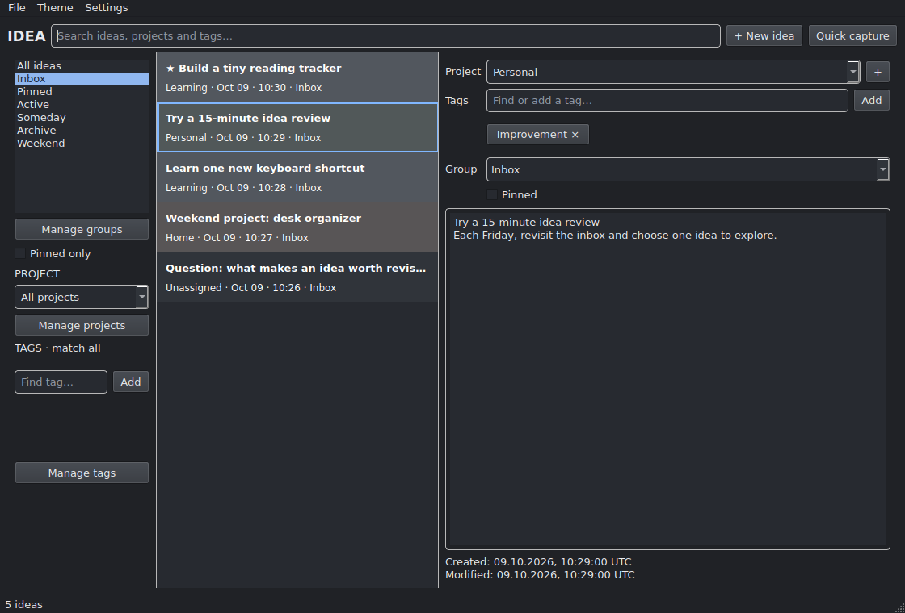
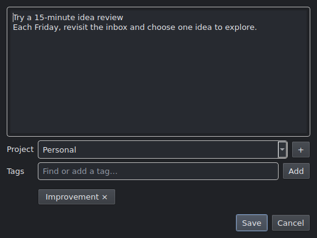

# Idea

A small, local offline idea manager for Ubuntu. Capture plain-text notes, find them
quickly, and organize them with projects, tags and manual groups. No accounts,
cloud services or AI.



## Install and run

Requires Python 3.12+ with `venv` and a desktop with Qt support.

```bash
python3 -m venv .venv
.venv/bin/python -m pip install -e .
.venv/bin/idea
```

Optional Ubuntu/GNOME setup for the panel icon, login startup and global shortcut:

```bash
.venv/bin/python tools/install_desktop.py
.venv/bin/python tools/install_shortcut.py
```

Keep this checkout in place: installed launchers use its `.venv`. GNOME's shortcut
works on Wayland. Other desktops can bind `.venv/bin/idea --capture` themselves.

## Quickly add a note

1. Press **Ctrl+Alt+N** anywhere after installing the GNOME shortcut, or choose
   **+ Add note** from Idea's panel icon. Inside Idea, use **Ctrl+Shift+N**.
2. Write your idea. Project and tags are optional. For example:

   > Try a 15-minute idea review
   >
   > Each Friday, revisit the inbox and choose one idea to explore.

3. Press **Ctrl+Enter** to save it to Inbox. **Esc** asks before discarding unsaved
   content.



## Everyday use

- **Ctrl+N** creates an idea; **Ctrl+F** searches content, projects and tags.
- Edits autosave. **Ctrl+S** saves immediately; failed saves retain your edits.
- **Ctrl+P** pins an idea; **Ctrl+E** archives it. Right-click for restore,
  permanent deletion from Archive, movement between groups and creation details.
- **Manage groups** creates or removes custom groups. Removing a group returns
  its ideas to Inbox without deleting them. New ideas default to Inbox.
- Find all shortcuts under **Settings → Keyboard shortcuts**.
- Closing the main window keeps the panel icon running. **File → Quit Idea** or
  the tray's **Quit Idea** saves and exits.

## Your data

Notes stay in `~/.local/share/idea/ideas.db`; preferences are stored in
`~/.config/idea/config.toml`. XDG locations are respected. Automatic consistent
backups live beside the database in `backups/` (latest seven, checked at launch).
**File** offers manual backup, Markdown/JSON export and validated JSON import.
Never replace a database while Idea is running.

See the [full user guide](docs/user-guide.md) for backup restoration, portability,
desktop setup, limitations and measured performance. Screenshots contain only
fictional notes, rendered from temporary databases.

## Development

```bash
.venv/bin/python -m pip install -e '.[test]'
QT_QPA_PLATFORM=offscreen .venv/bin/python -m pytest -q
.venv/bin/python tools/screenshots.py
.venv/bin/python tools/benchmark.py
```

Tests use temporary data. Socket tests require permission to use local Unix
sockets. Benchmarks generate 10,000 sample ideas and `benchmark-preview.png`;
[recorded measurements](benchmark-results.json).
